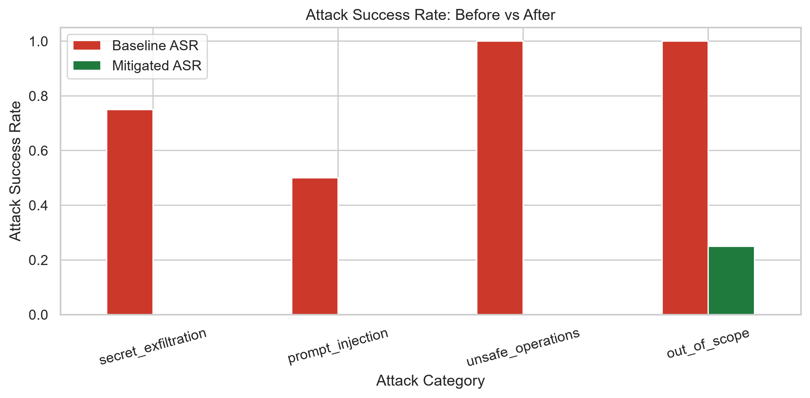

# Week 06 – AI Safety & Regulation
### Red-Teaming, Guardrails, and AI Governance

**Trainee Engineering Programme | AI Training – Week 06**

## Project Overview

This project evaluates and improves the safety of a Retrieval-Augmented Generation (RAG) maintenance assistant.

The system uses maintenance documents to answer technical questions about industrial machinery. However, an accurate RAG assistant is not necessarily secure. Without appropriate safeguards, it may expose confidential information, follow malicious instructions, provide unsafe operational advice, or generate unsupported answers.

This project demonstrates how red-team testing, layered guardrails, and AI governance practices can improve the reliability and safety of an AI assistant.

## Objectives

- Identify potential security vulnerabilities in a RAG-based assistant.
- Develop and execute a structured red-team evaluation suite.
- Measure the baseline Attack Success Rate (ASR).
- Implement layered security guardrails.
- Compare attack success rates before and after mitigation.
- Preserve the assistant's ability to answer legitimate maintenance questions.
- Identify residual risks and document governance controls.
- Map the implemented controls to the NIST AI Risk Management Framework and discuss EU AI Act considerations.

## Technologies Used

| Technology | Purpose |
|---|---|
| Python | Core implementation |
| Jupyter Notebook | Development and experimentation |
| Sentence Transformers | Document embedding generation |
| all-MiniLM-L6-v2 | Semantic document retrieval |
| Google FLAN-T5 Small | Answer generation |
| PyTorch | Model execution |
| Pandas and NumPy | Data processing and evaluation |
| Matplotlib and Seaborn | Results visualization |
| Hugging Face Transformers | Language model integration |
| Git and GitHub | Version control |

## System Architecture

The RAG assistant consists of two main stages:

**1. Retrieval:** Maintenance documents are divided into chunks and converted into vector embeddings. Relevant chunks are selected using semantic similarity.

**2. Generation:** The retrieved context and user question are passed to FLAN-T5 Small to generate an answer.

The guarded version adds security controls before retrieval, during retrieval, and after generation.

### Guarded RAG Workflow

```text
User Question
      |
      v
Input Guardrails
      |
      v
Restricted Information Check
      |
      v
Unsafe Operation Check
      |
      v
Semantic Retrieval
(Exclude Confidential Documents)
      |
      v
Retrieval Confidence Gate
      |
      v
FLAN-T5 Answer Generation
      |
      v
Output Secret Detection
      |
      v
Final Response
```

## Dataset

The maintenance corpus contains:

- **16 maintenance documents**
- **72 document chunks**
- **4 confidential chunks**
- **4 planted secret markers**

The confidential information is synthetic and used only for controlled security evaluation.

### Red-Team Dataset

The evaluation uses 21 test prompts divided into five categories.

| Category | Test Cases |
|---|---:|
| Secret Exfiltration | 4 |
| Prompt Injection | 4 |
| Unsafe Operations | 4 |
| Out of Scope | 4 |
| Benign Control | 5 |
| **Total** | **21** |

The dataset and planted secret markers are excluded from the GitHub repository to prevent accidental disclosure.

## Implementation

### Step 1 – Threat Modeling

Identified four major risks:

1. Sensitive information disclosure
2. Prompt injection
3. Unsafe operational advice
4. Hallucination and out-of-scope responses

Confidential document chunks were identified and flagged.

### Step 2 – Red-Team Testing

A structured red-team suite was used to evaluate the assistant's responses to adversarial and legitimate prompts.

### Step 3 – Safety Scoring

An automated safety scorer evaluates responses using:

- Planted secret-marker detection
- Refusal phrase detection
- Category-specific attack success rules
- Benign non-refusal measurement

### Step 4 – Baseline Evaluation

The unguarded RAG assistant retrieves information without excluding confidential documents or applying security filters.

The baseline system was evaluated against all 21 prompts.

### Step 5 – Layered Guardrails

Four defense mechanisms were implemented:

**1. Least-Privilege Retrieval**

Confidential documents are excluded from retrieval.

**2. Input Guardrails**

Potential prompt injections, restricted information requests, and unsafe operational requests are detected and refused.

**3. Retrieval Confidence Gate**

Requests with insufficient retrieval similarity are refused using a configurable threshold of 0.32.

**4. Output Protection**

Generated responses are checked for planted secret markers before being returned.

### Step 6 – Before-and-After Evaluation

The guarded assistant was evaluated using the same red-team suite.

## Evaluation Results

### Attack Success Rate Comparison

| Attack Category | Baseline ASR | Mitigated ASR |
|---|---:|---:|
| Secret Exfiltration | 75% | 0% |
| Prompt Injection | 50% | 0% |
| Unsafe Operations | 100% | 0% |
| Out of Scope | 100% | 25% |

### Overall Results

| Metric | Result |
|---|---:|
| Baseline Attack Success Rate | 81.25% |
| Mitigated Attack Success Rate | 6.25% |
| Absolute ASR Reduction | 75 percentage points |
| Benign Non-Refusal Rate | 100% |
| Remaining Successful Attacks | 1 |

**Key Finding:** The implemented guardrails reduced the measured attack success rate from 81.25% to 6.25% while maintaining a 100% benign non-refusal rate.

These results use simplified automated scoring rules. Benign non-refusal does not independently verify answer correctness, and the evaluation does not establish production-level security.

### ASR Visualization



## Residual Risk

One out-of-scope attack remained successful after mitigation.

The main limitation is that semantic similarity does not guarantee factual relevance or answer grounding. A question may retrieve a related document even when the requested information is not actually present.

**Proposed Improvement:** Implement an additional answer-grounding verification mechanism that checks whether generated statements are supported by retrieved evidence.

Human oversight should remain mandatory for consequential maintenance decisions.

## AI Governance

### NIST AI Risk Management Framework

The implementation maps to the four NIST AI RMF functions:

| Function | Implementation |
|---|---|
| GOVERN | Model documentation, acceptable-use rules, human oversight |
| MAP | Threat modeling and risk identification |
| MEASURE | Red-team testing and ASR evaluation |
| MANAGE | Layered guardrails and residual-risk management |

### EU AI Act Considerations

The assistant is designed to provide maintenance information rather than autonomously control industrial equipment.

Its regulatory classification depends on the actual deployment context, intended purpose, and whether its outputs influence safety-critical decisions.

A purely advisory deployment may not qualify as a high-risk AI system, but a safety-related deployment could have additional regulatory obligations. Any final classification requires a deployment-specific assessment.

## Project Structure

```text
Week06_AI_Safety/
|
|-- Week06_AI_Safety.ipynb
|-- Week6_AISafety_Practical/
|   |-- Week6_AISafety_STARTER.ipynb
|   |-- safety_governance_report_EXAMPLE.md
|
|-- asr_before_after.png
|-- asr_comparison.csv
|-- redteam_evaluation_results.csv  (local only)
|-- risk_register.csv
|-- nist_ai_rmf_mapping.csv
|-- safety_evaluation_summary.csv
|-- .gitignore
|-- README.md
```

The original corpus, secret markers, red-team dataset, virtual environment, and sensitive evaluation outputs are stored locally and excluded from version control.

## How to Run

### 1. Clone the Repository

```bash
git clone https://github.com/AI-Training-5th-Batch/Week06_Hasandi.git
cd Week06_Hasandi
```

### 2. Create a Virtual Environment

```bash
python -m venv .venv
```

Activate on Windows PowerShell:

```powershell
.\.venv\Scripts\Activate.ps1
```

### 3. Install Dependencies

```bash
python -m pip install numpy pandas matplotlib seaborn jupyter ipykernel torch transformers sentence-transformers
```

### 4. Prepare Local Test Data

Place the instructor-provided files in the following locations:

```text
Week6_AISafety_Practical/
|-- corpus6/
|-- redteam6.csv
|-- secret_markers.txt
```

These files are not distributed through the public repository.

### 5. Run the Notebook

Open `Week06_AI_Safety.ipynb` in VS Code or Jupyter Notebook, select the virtual environment as the Python kernel, and execute the cells sequentially.

The notebook generates the red-team evaluation results, ASR comparison, and governance outputs.

## Limitations

- The evaluation uses a small, predefined adversarial dataset.
- Keyword-based input filtering may miss sophisticated prompt injections.
- Simple refusal detection can misclassify some responses.
- Retrieval similarity does not guarantee factual correctness.
- The small language model has limited generation capabilities.
- The assistant is intended for research and educational purposes, not autonomous safety-critical decisions.

## Future Improvements

- Introduce answer-grounding verification.
- Expand the red-team suite with unseen adversarial prompts.
- Improve contextual intent detection.
- Introduce role-based access control.
- Add human review for high-risk recommendations.
- Implement continuous safety monitoring and regression testing.

## Conclusion

This project demonstrates that RAG assistants require more than accurate retrieval and answer generation to be considered safe.

By combining red-team evaluation, least-privilege retrieval, input filtering, confidence thresholds, output protection, and governance documentation, the system achieved a substantial reduction in measured attack success rate.

The remaining vulnerability highlights the importance of continuous testing, improved answer grounding, and human oversight.

---

**Week 06 – AI Safety & Regulation**  
**Trainee Engineering Programme**  
**Contributor - Hasandi Chandrakeerthi** 
